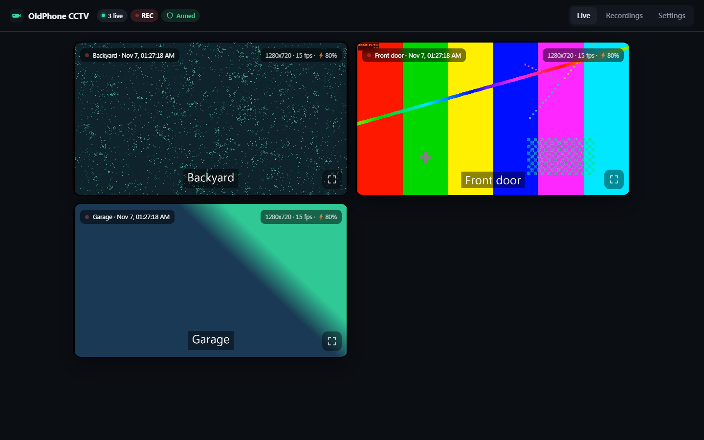
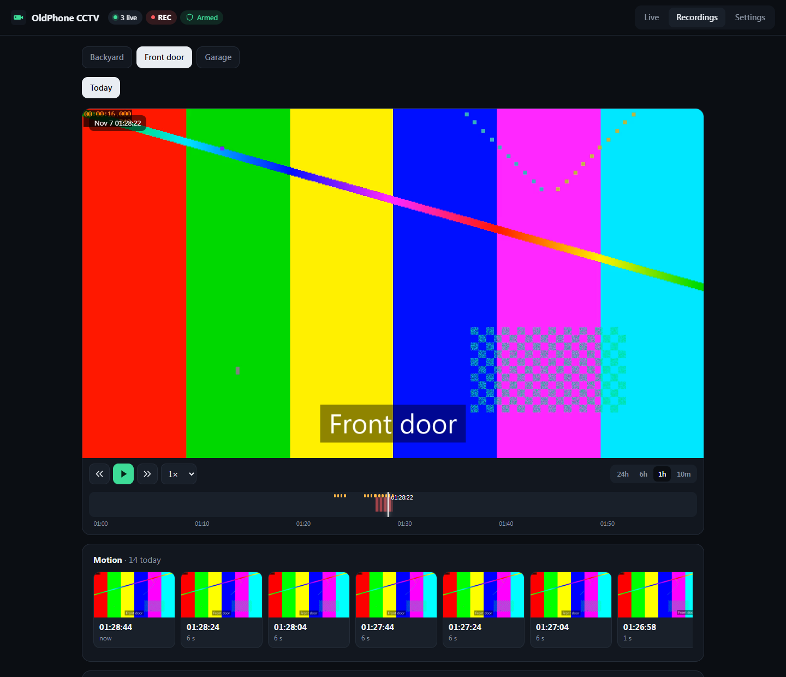
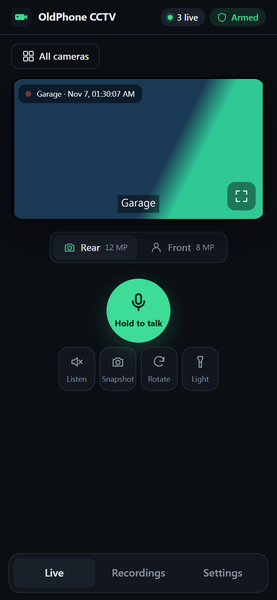

<h1 align="center">OldPhone CCTV</h1>

<p align="center"><b>Turn the old Android phone in your drawer into a CCTV security camera.</b><br>
Live view, 24/7 recording, motion alerts to your phone, and two-way talk. Self-hosted on your own PC,
with no cloud, no account, no subscription and no Docker.</p>

<p align="center">
  <a href="../../releases/latest"><b>Download for Windows</b></a> ·
  <a href="#quick-start">Quick start</a> ·
  <a href="#features">Features</a> ·
  <a href="docs/FAQ.md">FAQ</a>
</p>



<sub>Screenshots use the built-in simulated cameras (`dev/fake_phone.py`), which is why they show test patterns.</sub>

## Why

Old phones have a good camera, a microphone, a speaker, Wi-Fi and a battery that rides out power cuts.
Projects for using them as cameras either died ([Haven](https://github.com/guardianproject/haven),
[spydroid](https://github.com/fyhertz/spydroid-ipcamera)) or only cover the camera half, leaving you to wire up
an NVR such as Frigate yourself. OldPhone CCTV is both halves in one download.

## Features

- **Live view** of every camera in a grid. Tap one for full screen, switch lens (rear/front), flashlight, rotate,
  snapshot. Low latency (WebCodecs), works in Chrome, Edge and Safari, including on your phone.
- **Two-way audio.** *Listen* to the camera's microphone, and **hold to talk** through its speaker.
- **Continuous recording** to compressed MP4 (H.264 + AAC, about 0.5 GB per hour at 720p/15 fps). Old footage
  is deleted after 1 to 14 days, your choice. Recording is crash-safe: a power cut loses seconds, not the clip.
- **One timeline per day** instead of a folder of files. Drag to scrub, zoom 24h/6h/1h/10m, play at up to 16×.
  **Export any time range** as a single video.
- **Motion detection on the phone**, so it costs the PC nothing and scales to many cameras. It ignores lighting
  changes and auto-exposure.
- **Motion alerts to your phone** with a snapshot, through [ntfy](https://ntfy.sh) (free, open source, Android and
  iPhone) or Telegram. Tapping the alert opens the recording at that moment. Arm or disarm with one tap.
- **Multi-camera.** Phones on your Wi-Fi are found and paired automatically.
- **Reachable from anywhere** with [Tailscale](https://tailscale.com): private HTTPS, no port forwarding.
- **Surveillance mode** (optional, over USB) strips the phone down to camera-only for lower power and heat.
  It disables other apps (nothing is uninstalled) and turns off Bluetooth, location, mobile data and the screen.
  **Normal mode** puts back exactly what it changed.
- **The phone restarts itself** after a reboot or power cut, with no app to open and nothing to tap.
- **Small and dependency-free.** A 33 KB Android app with no libraries, and a Python standard-library server. FFmpeg
  and adb come bundled in the Windows release.

| Recordings and motion events | On your phone |
|---|---|
|  |  |

## Quick start

**You need:** an Android phone (7.0 or newer, any camera works), a Windows PC that stays on, both on the same Wi-Fi.

1. **PC:** download the [latest release](../../releases/latest) zip, extract it (e.g. to `D:\OldPhoneCCTV`),
   right-click **`setup.ps1` → Run with PowerShell**, then double-click **`Start CCTV.bat`**.
   The viewer opens at `http://localhost:8090`.
2. **Phone:** install `OldPhoneCCTV.apk` from the release, either from the phone's browser or with the PC:
   enable USB debugging, plug it in, and setup installs it for you. Open the app and tap **Start camera**.
3. The phone appears in the viewer within seconds and pairs with your PC. Done.
   Put it on a charger and point it where you want. The screen can stay off.

**Watch from your phone:** install Tailscale on the PC and your phone, then run `setup.ps1` again. It prints a
private `https://your-pc.your-tailnet.ts.net` address. Browsers only allow live video decoding and the microphone
on HTTPS pages, which is why this step matters. Use **Add to Home screen** to get it as an app.

**Motion alerts:** Settings → *Alerts to your phone* → **New**, then **Save**. Install **ntfy**, subscribe to that
topic, and press **Send a test alert**.

More detail: [Setup guide](docs/SETUP.md) · [FAQ and troubleshooting](docs/FAQ.md) · [How it works](docs/ARCHITECTURE.md)

## How it works

```
 Old phone (app)                         Your PC (server/cctv.py)                       You
 camera -> H.264 encoder  ─┐                                                    ┌─> browser / phone (live, talk)
 mic    -> 16 kHz PCM     ─┼─ TCP 47801 ─> per camera: recorder ─> MP4 clips ───┼─> timeline, export
 motion -> event + JPEG   ─┘   (Wi-Fi      motion events (SQLite) ─> alerts ────┼─> ntfy / Telegram push
 speaker <- talk audio   <──    or USB)    web viewer :8090 ─> tailscale serve ─┘
```

The phone does the expensive work in hardware (encoding, motion detection), so the PC only copies streams into
files with FFmpeg. Details are in [docs/ARCHITECTURE.md](docs/ARCHITECTURE.md).

## Status

**v1.0, working and in daily use** on a Xiaomi Mi A2 (stock Android 10). Windows is the packaged platform. The server
is plain Python and should run on Linux and macOS with `ffmpeg` and `adb` installed, but that isn't packaged or
tested yet. Help wanted: Linux/macOS packaging, more phones tested, iOS/Android viewer apps.

## Contributing

Issues and pull requests are welcome. No phone needed to hack on the server or viewer:

```bash
python dev/fake_phone.py --name "Front door" --port 47901 --source bars
python dev/fake_phone.py --name "Garage" --port 47902 --source gradient
python server/cctv.py
```

The phone app builds without Android Studio or Gradle: `android/build.ps1` needs only the Android SDK and a JDK.

## Licence

[MIT](LICENSE). FFmpeg (bundled in releases) is LGPL/GPL, see `tools/FFMPEG-LICENSE.txt` in the release.
Not affiliated with Xiaomi, Google, Tailscale or ntfy.
